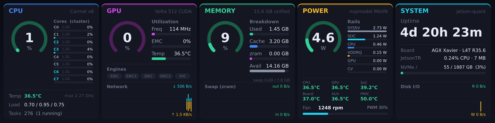

# JetsonTR

[English](README.md) | **한국어**

**JetsonTR**은 Thermalright Trofeo Vision 9.16" USB LCD(1920×480)를 **NVIDIA Jetson AGX Xavier**의 시스템 모니터로 바꿔 줍니다.
USB bulk 전송으로 화면을 직접 보내므로 제조사 드라이버가 필요 없습니다.

macOS 버전인 [MacTR](https://github.com/beret21/MacTR)의 Jetson판입니다. TR은 Thermalright를 뜻합니다.



## 하드웨어

- **디스플레이:** Thermalright Trofeo Vision 9.16 LCD (9.16인치, 1920×480 IPS, USB Type-C, 자석 거치)
  - 제조사: [블랙](https://www.thermalright.com/product/trofeo-vision-9-16-lcd-black/) · [화이트](https://www.thermalright.com/product/trofeo-vision-9-16-lcd-white/)
  - 아마존: [Trofeo Vision 9.16 LCD Black](https://www.amazon.com/dp/B0FX7SH64X)
  - 테스트한 장치: ARGB가 없는 모델, USB VID `0x0416` / PID `0x5408`. ARGB 모델은 테스트하지 않았습니다.
- **호스트:** NVIDIA Jetson AGX Xavier 16GB (JetPack 5.1.6 / L4T R35.6)

## 화면 구성

| 패널 | 내용 | 출처 |
|---|---|---|
| CPU | Carmel 8코어(2코어 × 4클러스터)의 코어별 사용률과 주파수, 온도, 부하, 프로세스 수 | `/proc/stat`, `cpufreq`, `thermal_zone`, `/proc/loadavg` |
| GPU | Volta GPU 사용률과 주파수, EMC(메모리 대역폭) 사용률, 온도, NVENC/NVDEC/VIC 동작 여부, 네트워크 추이 | `tegrastats`, `17000000.gv11b/devfreq`, `host1x/*/load`, `/proc/net/dev` |
| MEMORY | 통합 메모리의 Used / Cache / zram / Available, zram 스왑 입출력 추이 | `/proc/meminfo`, `/sys/block/zram*/mm_stat`, `/proc/vmstat` |
| POWER | 전체 전력과 레일별 전력(W), 온도 센서 6곳, 팬 rpm과 PWM | `tegrastats`(root 필요), `thermal_zone`, `hwmon` |
| SYSTEM | 시계와 날짜, 가동 시간, NVMe 사용량, 디스크 I/O 추이 | `/proc/uptime`, `statvfs`, `/proc/diskstats` |

## 요구 사항

- Jetson AGX Xavier, JetPack 5.x(L4T R35)에서 테스트했습니다. 다른 Jetson 모델은 sysfs 경로가 다를 수 있습니다.
- Python 3.8+, `pyusb`, `Pillow`, `libusb-1.0`
- 글꼴: DejaVu Sans (`fonts-dejavu-core`)

```bash
sudo apt install python3-usb python3-pil libusb-1.0-0 fonts-dejavu-core
```

## 사용법

```bash
# 장치 없이 한 프레임을 PNG로 렌더링
python3 jetson_lcd_monitor.py --png img/preview.png

# 핸드셰이크만 실행 / 10초 컬러 테스트 화면
python3 trlcd_test.py --handshake-only
python3 trlcd_test.py --seconds 10

# LCD 구동 (전력 레일 값은 root에서만 읽힘)
sudo python3 jetson_lcd_monitor.py --no-rotate --brightness 1.6
```

| 옵션 | 설명 |
|---|---|
| `--interval N` | 메트릭 수집과 렌더 주기(초), 기본값 2 |
| `--no-rotate` | 프레임을 180° 회전하지 않음 (LCD 장착 방향에 맞게 선택) |
| `--brightness F` | 보내기 전에 RGB에 곱하는 밝기 배율, 기본값 1.0 |
| `--png PATH` | 장치 없이 PNG 한 장을 저장하고 종료 |

### 서비스로 상시 실행 (systemd)

```bash
# 일반 사용자 접근 허용 (plugdev 그룹)
sudo cp udev/99-thermalright.rules /etc/udev/rules.d/
sudo udevadm control --reload-rules && sudo udevadm trigger

# 서비스 설치. 먼저 경로와 PYTHONPATH를 환경에 맞게 고치세요.
sudo cp systemd/thermalright-lcd.service /etc/systemd/system/
sudo systemctl daemon-reload
sudo systemctl enable --now thermalright-lcd
journalctl -u thermalright-lcd -f
```

## 동작 방식

- **스레드:** 수집 스레드와 렌더 스레드가 각각 2초마다 동작합니다. 프레임이 끊기면 LCD가 꺼지기 때문에 메인 루프는 캐시된 JPEG를 0.5초마다 다시 보냅니다.
- **프로토콜 (LY)**
  - 핸드셰이크: 2048B를 보내고 512B 응답을 받아 PM/SUB/FBL을 얻습니다. 이 장치는 PM=65, FBL=192, 1920×480으로 응답합니다.
  - 프레임: JPEG(650KB 이하)를 16B 헤더와 496B 데이터로 된 512B 청크로 나눕니다. 청크 수는 크기/496을 올림한 값이고 4의 배수로 채웁니다. 청크는 최대 4096B씩 bulk OUT(0x09)으로 보내고, bulk IN(0x81)에서 512B ACK를 읽습니다.
  - 전원을 켠 뒤 첫 핸드셰이크는 `resp[8]=0x02`(준비 안 됨)를 돌려줄 수 있어서 재시도합니다.
- **복구:** 전송이 실패하거나 장치가 분리되면 장치를 닫고 5초 뒤 다시 엽니다. `tegrastats`가 종료되면 다시 시작합니다.
- **성능:** 렌더링은 2배 슈퍼샘플링을 쓰며 Xavier에서 프레임당 약 290ms 걸립니다. JPEG 인코딩은 약 40ms 걸립니다.

## 감사의 말

- [thermalright-trcc-linux](https://github.com/Lexonight1/thermalright-trcc-linux): LY bulk 프로토콜 역공학 (`src/trcc/adapters/device/ly.py`)
- [MacTR](https://github.com/beret21/MacTR): 이 화면 레이아웃의 바탕이 된 macOS 버전
- [Claude Code](https://claude.com/claude-code)로 만들었습니다. Mac 세션과 Jetson 세션이 세션 간 메시지로 프로토콜 문서와 화면 사양을 주고받았습니다.

## 라이선스

MIT. [LICENSE](LICENSE)를 참고하세요.
LY 프로토콜 정보(USB ID, 핸드셰이크, 청크 형식)는 [thermalright-trcc-linux](https://github.com/Lexonight1/thermalright-trcc-linux)(GPL-3.0)를 참조했습니다. 구현은 직접 했고 구조도 다르며, 그 프로젝트의 코드나 C#에서 넘어온 관행은 가져오지 않았습니다. 이 저장소에는 그 프로젝트의 코드가 포함되어 있지 않습니다.
