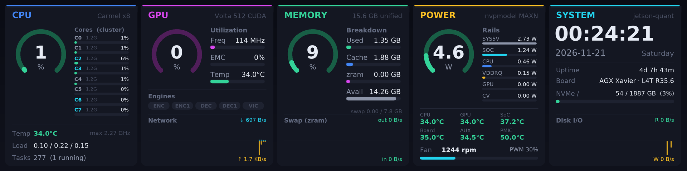

# JetsonTR

**JetsonTR**은 Thermalright Trofeo Vision 9.16" USB LCD(1920×480)를 **NVIDIA Jetson AGX Xavier**의 시스템 모니터로 쓰는 프로그램입니다.
제조사 드라이버 없이 USB bulk 전송으로 화면을 직접 보냅니다.

A system monitor for NVIDIA Jetson AGX Xavier, rendered on a Thermalright Trofeo Vision 9.16" USB LCD (VID 0x0416 / PID 0x5408) via raw USB bulk transfers.



## 화면 구성

| 패널 | 내용 | 출처 |
|---|---|---|
| CPU | Carmel 8코어(2코어×4클러스터) 코어별 사용률·주파수, 온도, 부하, 프로세스 수 | `/proc/stat`, `cpufreq`, `thermal_zone`, `/proc/loadavg` |
| GPU | Volta GPU 사용률·주파수, EMC(메모리 대역폭) 사용률, 온도, NVENC/NVDEC/VIC 동작 여부, 네트워크 추이 | `tegrastats`, `17000000.gv11b/devfreq`, `host1x/*/load`, `/proc/net/dev` |
| MEMORY | 통합 메모리 Used / Cache / zram / Available, zram 스왑 입출력 추이 | `/proc/meminfo`, `/sys/block/zram*/mm_stat`, `/proc/vmstat` |
| POWER | 전원 레일별 전력(W) 합계와 개별 값, 온도 6곳, 팬 rpm·PWM | `tegrastats`(root 필요), `thermal_zone`, `hwmon` |
| SYSTEM | 시계·날짜, 가동 시간, NVMe 사용량, 디스크 I/O 추이 | `/proc/uptime`, `statvfs`, `/proc/diskstats` |

## 요구 사항

- Jetson AGX Xavier, JetPack 5.x(L4T R35)에서 확인했습니다. 다른 Jetson은 sysfs 경로가 다를 수 있습니다.
- Python 3.8+, `pyusb`, `Pillow`, `libusb-1.0`
- 글꼴: DejaVu Sans (`fonts-dejavu-core`)

```bash
sudo apt install python3-usb python3-pil libusb-1.0-0 fonts-dejavu-core
```

## 사용법

```bash
# 장치 없이 한 프레임을 PNG로 렌더링
python3 jetson_lcd_monitor.py --png img/preview.png

# 핸드셰이크만 해 보기 / 단색 테스트 화면 10초
python3 trlcd_test.py --handshake-only
python3 trlcd_test.py --seconds 10

# LCD 구동 (전력 레일 값은 root에서만 읽힘)
sudo python3 jetson_lcd_monitor.py --no-rotate --brightness 1.6
```

| 옵션 | 설명 |
|---|---|
| `--interval N` | 메트릭 수집·렌더 주기(초), 기본 2 |
| `--no-rotate` | 180° 회전하지 않음 (LCD 장착 방향에 따라 선택) |
| `--brightness F` | 보내기 전에 RGB에 곱하는 밝기 배율, 기본 1.0 |
| `--png PATH` | 장치 없이 PNG 한 장 저장 후 종료 |

### 상시 실행 (systemd)

```bash
# 일반 사용자 접근 권한 (plugdev 그룹)
sudo cp udev/99-thermalright.rules /etc/udev/rules.d/
sudo udevadm control --reload-rules && sudo udevadm trigger

# 서비스 등록 — 경로와 PYTHONPATH는 환경에 맞게 수정
sudo cp systemd/thermalright-lcd.service /etc/systemd/system/
sudo systemctl daemon-reload
sudo systemctl enable --now thermalright-lcd
journalctl -u thermalright-lcd -f
```

## 동작 방식

- **스레드 분리**: 수집 스레드와 렌더 스레드가 2초마다 동작하고, 메인 루프는 캐시된 JPEG를 0.5초마다 다시 보냅니다. 프레임이 끊기면 LCD가 꺼지기 때문입니다.
- **프로토콜 (LY)**
  - 2048B 핸드셰이크를 보내고 512B 응답을 받아 PM/SUB/FBL을 얻습니다. 이 장치는 PM=65, FBL=192, 1920×480입니다.
  - 프레임은 JPEG(650KB 이하)를 16B 헤더 + 496B 데이터의 512B 청크로 나누고, 4096B 단위로 bulk OUT(0x09) 전송한 뒤 512B ACK(0x81)를 받습니다.
  - 전원을 켠 뒤 첫 핸드셰이크는 `resp[8]=0x02`(준비 안 됨)로 응답할 수 있어서 재시도합니다.
- **복구**: 전송이 실패하거나 장치가 분리되면 닫고 5초 뒤 다시 연결합니다. `tegrastats`가 종료되면 재시작합니다.
- 렌더는 2배 슈퍼샘플링 후 축소하며, Jetson에서 프레임당 약 290ms, JPEG 인코딩은 약 40ms입니다.

## 참고

- 프로토콜 출처: [thermalright-trcc-linux](https://github.com/Lexonight1/thermalright-trcc-linux) (`src/trcc/adapters/device/ly.py`)
- macOS용 자매 프로젝트: [MacTR](https://github.com/beret21/MacTR) (화면 디자인 기반)
- 이 프로젝트는 [Claude Code](https://claude.com/claude-code)로 개발했습니다. Mac 세션과 Jetson 세션이 메시지를 주고받으며 프로토콜과 화면 사양을 넘겨받았습니다.

## License

MIT — see [LICENSE](LICENSE). 프로토콜은 thermalright-trcc-linux(GPL-3.0)의 역공학 결과를 사양으로 참고했으며, 그 코드는 포함하지 않았습니다.
